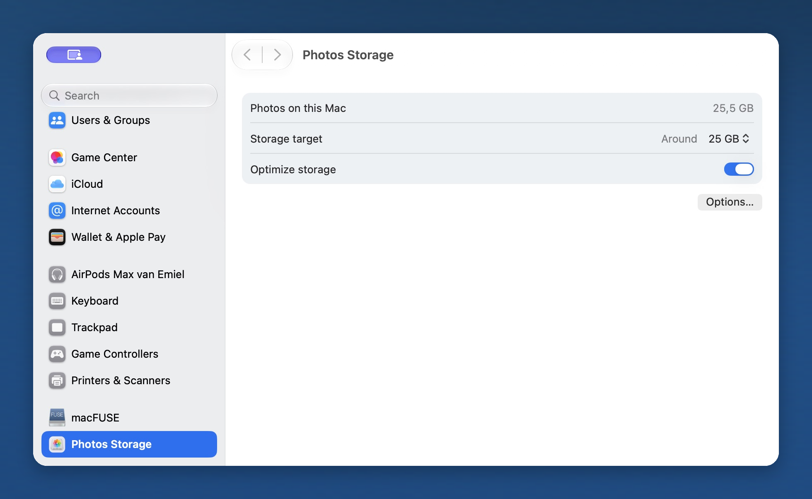

  

<h1 align="center">Photos Storage</h1>

  A storage target for Photos. Right in System Settings.

  <a href="https://github.com/emieljanson/photos-storage/releases/download/v0.3.1/Photos-Storage-0.3.1-arm64.zip"><strong>Download for Apple silicon</strong></a>
  &nbsp;·&nbsp;
  <a href="https://github.com/emieljanson/photos-storage/releases/tag/v0.3.1">Release notes</a>

  Apple silicon · Current download: macOS 27.2, build 26B123

  

- **Choose a target.** See how much space Photos uses locally and choose an amount from 20 GB.
- **Keep it in Settings.** A small native pane, with no menu bar or Dock icon.
- **Let it run.** Background monitoring continues every five minutes, even after System Settings closes.

The target is approximate. The Photos catalog, requested downloads, and temporary
files can take it above the amount you choose.

## Get started

1. Unzip the download, move **Photos Storage.app** to **Applications**, and open it.
2. Follow setup to allow access to **Photos Library** and **Photos Settings**.
3. Choose **Open System Settings**, select a target, and turn on **Optimize storage**.

The app is Developer ID signed and notarized by Apple. Signed automatic updates
are included. Opening the app later takes you back to its settings.

[Setup and troubleshooting](docs/HELP.md)

## Compatibility

Requires an **Apple silicon Mac**, **iCloud Photos**, and **Optimize Mac Storage**.
The published **0.3.1** download requires **macOS 27.2, build 26B123**.
The **0.4.0** source targets **macOS 13 and later**, with runtime checks tested on
macOS 15, 26, and 27. Its download is being prepared. Photos Storage checks that
the required Photos features are available before changing settings or freeing
local copies.
This uses private macOS interfaces; [compatibility checks](docs/COMPATIBILITY.md)
cover the tested versions and runtime safeguards.

Photos Storage asks macOS to release eligible local copies. It does not delete
items from your Photos library. macOS decides what can be freed, and Photos
still needs free disk space to sync. This does not replace a backup.

## For developers

[How it works, build instructions, and tests](docs/DEVELOPMENT.md) ·
[Compatibility checks](docs/COMPATIBILITY.md) · [Interface design](DESIGN.md) ·
[Release process](RELEASING.md)

## License

[MIT](LICENSE). An independent project, not affiliated with Apple.
